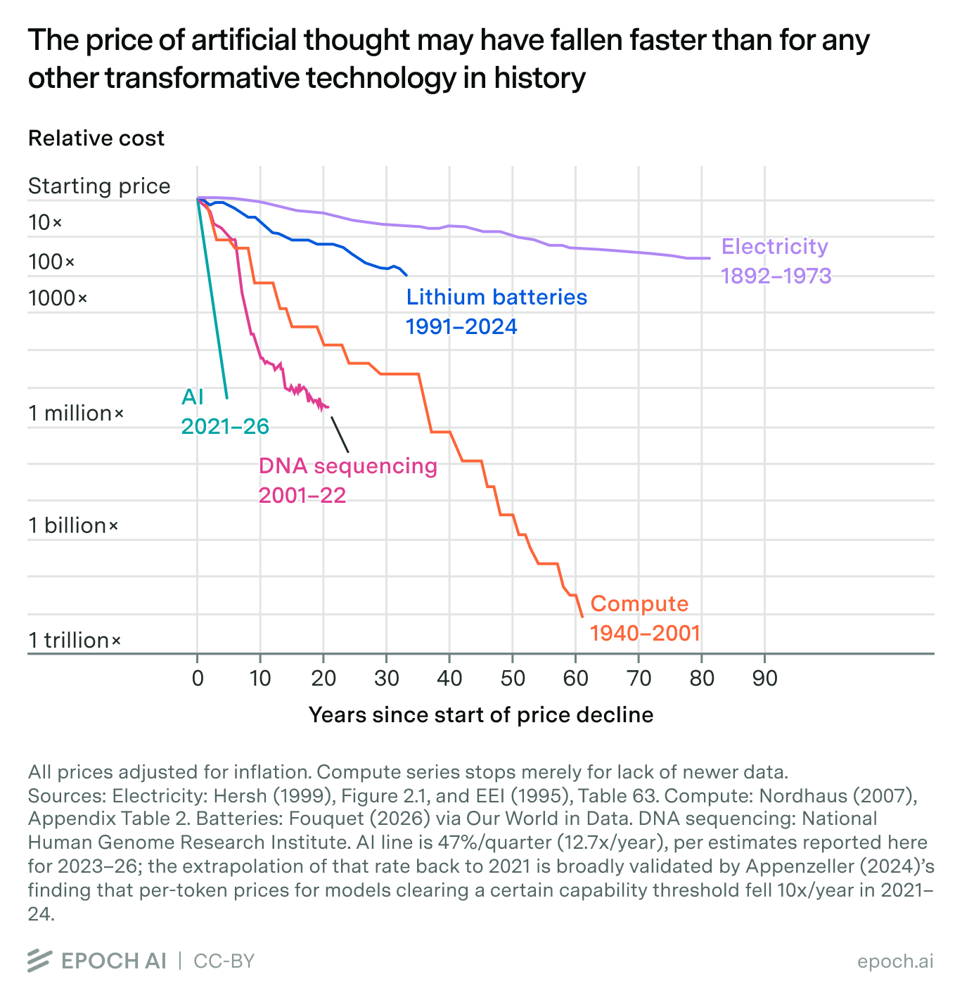

> Thoughts inspired by [Boyuan Chen](https://scholar.google.com/citations?user=9OdMvbAAAAAJ&hl=en)
## TL;DR
- The "embodied brain" may not last as a separate model. It looks more like one of many things LLMs can do.
- Cloud inference latency is already close to 2 Hz. LLMs will take over the niche of robotics foundation models.
- The on-device model handles following and safety. It doesn't need to finish tasks by itself.
- At the model level, the open problems are mostly Simulation and Evaluation.

## Introduction

OpenAI and Anthropic started working on robotics in 2025. Work on RoboAgents goes back further, to 2022 ([Code as Policies](https://arxiv.org/abs/2209.07753)). For a long time LLM for Robotics didn't get much attention. That changed with Anthropic's [Project Fetch](https://www.anthropic.com/research/project-fetch-robot-dog), and then with GPT-6 Astra in September, which did well on a wide range of tasks.

A year ago, Claude and GPT couldn't do even the simplest joint control without a lot of hand-written control logic, and I thought LLMs were still a long way from this. A year later that is no longer true. GPT-6 Astra generalizes very well on two-finger gripper grasping, and it keeps retrying and adjusting until it gets more complex tasks done. At that point, the models we used to call "specialized" lose most of their advantage.

So I've been asking where Robotics Researchers go from here, especially the ones who used to work on the brains.

## Part 1: Does Robotics Need a Foundation Model?

The best open-source on-robot model is still [π0.5](https://www.pi.website/blog/pi05), released by [Physical Intelligence](https://www.pi.website) in April 2025. In China's embodied AI boom earlier this year, most of the demos we saw were fine-tuned from π0.5. Only a few were built on in-house models.

If you have used π0.5, you know how it behaves: it can overfit a single scene well, but it doesn't understand text or scenes much beyond that. It doesn't have enough parameters or data. Here are the parameters and training data of the VLAs and WAMs that have done well recently:

<figure class="blog-figure" style="display: block; margin: 1.5em auto; text-align: center">

<figcaption>Model Size vs. Training Data</figcaption></figure>

Scaling is a science. If we want an embodied foundation brain, we have to take parameters and data seriously. [Natura-1](https://www.naturewill.com/blog/natura-1#heading-observations) is probably the most impressive Robotics Foundation Model of the last few months, and even at 50B parameters it still can't handle real-world use.

So does robotics need its own foundation model? I don't think so. System 2 models have already shown that they generalize. I don't expect Robotics Intelligence to be a separate field. Like Coding and AI4Science, it will be an application of LLMs.

Here is how I picture it:
1. An LLM System 2 understands instructions and turns them into something it can send to the robot. Right now I'm thinking of eef poses, with latency between 200 and 400 ms.
2.  An on-device Adapter does two things:
	- Following: it tracks what System 2 sends, reacts quickly to tactile input in contact-rich tasks, and keeps adjusting from vision and motor feedback. It needs (almost) no planning.
	- Safety: when the network drops, it finishes the task at a minimum level or goes into a safe mode. If the connection cuts out while it is chopping vegetables, it puts the knife down somewhere safe.

<figure class="blog-figure" style="display: block; margin: 1.5em auto; text-align: center">

<figcaption>Cloud System 2 + On-device Adapter</figcaption></figure>

Yujun Shen of Robbyant said at the Inclusion·Conference on the Bund in September 2026 that embodied models will end up as tools that higher-level LLMs call. I agree.

## Part 2: Latency and Cost
People raise plenty of objections to LLMs here. These two come up most:
1. Can latency get low enough to support responsive closed-loop control? (ref. [Shitao Tang](https://x.com/TsT87648373/status/2121695916654842158), [Astranomy](https://research.nvidia.com/labs/srl/projects/astranomy/index.html), [SemiAnalysis](https://newsletter.semianalysis.com/p/a-brain-too-big-to-carry-on-device))
2. Can cost get low enough for robots to do real-world tasks? (ref. [Astranomy](https://research.nvidia.com/labs/srl/projects/astranomy/index.html), [InferenceWire](https://inferencewire.com/insights/ai-models-are-learning-to-run-robot-arms-but-slowly))

### Latency

When I talk with people about what LLMs mean for robotics foundation models, latency is the first thing most of them bring up. Today, GPT-6 Astra or Fable 5.2 takes about 50 s to do one pick & place in simulation (thinking=high, single trial). I think the worry is misplaced. A VLA runs in real time because its VLM does one forward pass and an action expert turns that into actions. The simplest thing is to do the same with Astra: connect it to an action expert through an IDM or a joint forward pass, and have it output actions directly. If Astra reaches 100+ TPS and OpenAI is willing to deploy it, producing one action in the cloud is no big deal, as long as you aren't prefilling a very long memory.

Let's work through the numbers. GPT-6 Astra isn't open source, so I use [DeepSeek V4.1 Flash](https://huggingface.co/deepseek-ai/DeepSeek-V4.1-Flash) (DSV4.1 Flash below; 552B, prefill 8B / decode 16B Activated, Non-Think).

One cloud call has a network part and a server part:

$$
T_{\text{call}} = T_{\text{net}} + T_{\text{server}}
$$

$$
T_{\text{net}} = T_{\text{RTT}} + T_{\text{upload}},\qquad
T_{\text{server}} = T_{\text{ViT}} + T_{\text{prefill}} + T_{\text{think}} + \frac{N_{\text{out}}}{R_{\text{decode}}}
$$

The setup is bimanual tabletop manipulation with 3 cameras at 640×480 (head + 2 wrist), Non-think. The model outputs xyz, rpy and gripper opening for both arms: 14 numbers, about 40 tokens, decoded at 200 tok/s. The system prompt and task description stay in the prefix cache, so each step only prefills the new frame.

- **Image tokens**: a 640×480 image becomes 1,610 patches of 14×14. After 3×3 downsampling, plus newline and separator tokens, that is 206 tokens (ref. [DSV4.1 Flash image_processor](https://huggingface.co/deepseek-ai/DeepSeek-V4.1-Flash/blob/main/inference/image_processor.py)). Three cameras plus about 100 text tokens give \\(N_{\text{new}} \approx 0.72\text{k}\\).
- **ViT**: the built-in encoder has about 411M parameters, plus a 73M aligner (ref. [DSV4.1 Flash config](https://huggingface.co/deepseek-ai/DeepSeek-V4.1-Flash/blob/main/config.json)). The 4,830 patches take about \\(5.1\times10^{12}\\) FLOPs, or about 7.5 ms on one B300 at 2.25 PFLOPS BF16 and 30% utilization. I take 15 ms to cover overhead.
- **Prefill**: the faster providers have a TTFT of about 0.3 s. Minus one network round trip, that leaves 0.25 s, most of it queueing and scheduling at this input length.
- **Think**: 0 in Non-think. With thinking at Max, the time to first answer token is 12.41 s (ref. [Novita](https://novita.ai/compare/open-source-llm-vs-proprietary-llm)).
- **Action expert**: today's APIs only output actions as text. With an action expert like π0's (300M parameters, 10 flow matching steps), this step takes about 3 ms.

Put together:

<figure class="blog-figure" style="display: block; margin: 1.5em auto; text-align: center">

<figcaption>Cloud Call Latency</figcaption></figure>

Outside cross-border setups, latency is around 2 Hz today, which I think is acceptable for now. In our tests, an edge chip like NVIDIA's Orin AGX can hardly run a typical ~5B WAM under 500 ms without losing quality, and VLAs get to about 200 ms. Running on the robot isn't noticeably faster than running in the cloud.

Cloud latency will probably come down faster than on-device latency, too. The cloud has more demand and more use cases, and OpenAI, Anthropic and the others have more money.

### Cost

Cost is the other common objection. Some simple math, again with GPT-6 Astra: the robot works 8 hours a day and calls the model at 2 Hz. I use the Codex Pro 20x ($200) subscription here, because API key prices are high enough to distort the picture.

Calls per day:

$$
N_{\text{day}} = 2\ \text{Hz} \times 8 \times 3600\ \text{s} = 57{,}600
$$

Each call sends a 2k-token fixed prefix that hits the cache, 1,180 tokens of new observation (360 per image under Astra's rules, ref. [OpenAI Images and vision](https://developers.openai.com/api/docs/guides/images-vision), plus about 100 tokens of text), and gets 40 tokens back. On the Codex subscription, Astra uses 250 credits per million input tokens, about 25 for cached input, and 1,250 for output (ref. [usepoly](https://usepoly.co/codex-pricing)):

$$
c_{\text{call}} = \frac{\underbrace{2{,}000 \times 25}_{\text{prefix}} + \underbrace{1{,}180 \times 250}_{\text{new observation}} + \underbrace{40 \times 1{,}250}_{\text{output}}}{10^6} = 0.05 + 0.295 + 0.05 = 0.395\ \text{credit}
$$

$$
c_{\text{month}} = 0.395 \times 57{,}600 \times 30 \approx 683\text{K credits}
$$

Images are about 68% of that. One Pro 200 plan (\$200/month) comes with about 140K credits (ref. [BenchLeader](http://www.benchleader.com/coding-plans/codex-pro-500)), so one robot needs:

$$
\left\lceil \frac{683\text{K}}{140\text{K}} \right\rceil = 5\ \text{Pro 200 plans}
$$

About \$1,000 a month, or \$33 a day.

<figure class="blog-figure" style="display: block; margin: 1.5em auto; text-align: center">

<figcaption>Cost per Robot</figcaption></figure>

If LLMs for Robotics becomes something LLM Companies care about, costs will keep falling (ref. [Epoch AI](https://epoch.ai/publications/the-plunging-price-of-thought)). Even at 50% a year, which is very conservative, robotics products get cheap enough within 1–2 years.

Epoch AI has numbers on how fast this is going. At a fixed level of capability, the cost of AI has dropped about 47% per quarter since 2023, roughly 12.7× a year, faster than DNA sequencing, compute, lithium batteries or electricity ever did. Scoring 75% on GPQA Diamond cost about \$0.30 per question with o3 in early 2025. Less than 18 months later, GPT-5.6 Luna does it for \$0.0004, 725× cheaper. At that rate, the ~\$1,000 per robot per month above would fall below \$100 within a year.

<figure class="blog-figure" style="display: block; margin: 1.5em auto; text-align: center"><figcaption>Source: Emberson &amp; Roodman, Epoch AI (2026), CC BY 4.0</figcaption></figure>

## Conclusion

So where do VLA / WAM Researchers go? Unless the goal is short-term deployment, I don't see VLAs, WAMs, or any other attempt to scale a robotics-only foundation model holding up against LLMs (yes, I'm an Adventist, in the Three-Body sense).

If you want to work on the embodied brain itself, joining an LLM Company to do pre-training and post-training may be the better bet. Do the data work, and find out how much Ego, UMI and teleoperation data are worth for LLM pre/post training.

Robotics still has plenty of open problems. Leaving hardware iteration cycles aside, at the model level there are at least these:
1. Simulation: there is still no good simulation environment for robot rollouts. Simulators, world models and code as policy all need more work on large-scale parallel reinforcement learning and on closing the sim2real and real2sim gaps.
2. Evaluation: the "big bench" idea is that in any field, a good Benchmark ends up solving a lot of real problems. In Robotics, simulation Benchmarks don't reflect real-robot performance, and real-robot Benchmarks get hacked a lot and lack diversity and expressiveness. Robotics urgently needs a good Benchmark that tests how well models actually work and matches what people experience when they use them.

## Reference

1. Liang et al. (2022). *Code as Policies: Language Model Programs for Embodied Control*. [arXiv:2209.07753](https://arxiv.org/abs/2209.07753)
2. Anthropic. *Project Fetch*. [Anthropic Research](https://www.anthropic.com/research/project-fetch-robot-dog)
3. Physical Intelligence (2025). *π0.5: a Vision-Language-Action Model with Open-World Generalization*. [Blog](https://www.pi.website/blog/pi05), [arXiv:2504.16054](https://arxiv.org/abs/2504.16054)
4. Nature Will (2026). *Natura-1: The Will to Act*. [Blog](https://www.naturewill.com/blog/natura-1)
5. Black et al. (2024). *π0: A Vision-Language-Action Flow Model for General Robot Control*. [arXiv:2410.24164](https://arxiv.org/abs/2410.24164)
6. NVIDIA (2026). *Isaac GR00T* (GR00T N1.7). [GitHub](https://github.com/NVIDIA/Isaac-GR00T)
7. Wu et al. (2026). *A Pragmatic VLA Foundation Model* (LingBot-VLA). [arXiv:2601.18692](https://arxiv.org/abs/2601.18692)
8. Wang et al. (2026). *Qwen-VLA: Unifying Vision-Language-Action Modeling across Tasks, Environments, and Robot Embodiments*. [arXiv:2605.30280](https://arxiv.org/abs/2605.30280)
9. Liu et al. (2026). *RDT2: Exploring the Scaling Limit of UMI Data Towards Zero-Shot Cross-Embodiment Generalization*. [arXiv:2602.03310](https://arxiv.org/abs/2602.03310)
10. Luo et al. (2026). *Being-H0.5: Scaling Human-Centric Robot Learning for Cross-Embodiment Generalization*. [arXiv:2601.12993](https://arxiv.org/abs/2601.12993)
11. Jiang et al. (2025). *Galaxea Open-World Dataset and G0 Dual-System VLA Model*. [arXiv:2509.00576](https://arxiv.org/abs/2509.00576)
12. GigaBrain Team (2025). *GigaBrain-0: A World Model-Powered Vision-Language-Action Model*. [arXiv:2510.19430](https://arxiv.org/abs/2510.19430)
13. Figure (2025). *Helix: A Vision-Language-Action Model for Generalist Humanoid Control*. [Blog](https://www.figure.ai/news/helix)
14. Xiaomi Robotics Team (2026). *Xiaomi-Robotics-1: Scaling Vision-Language-Action Models with over 100K Hours of Real-World Trajectories*. [arXiv:2607.15330](https://arxiv.org/abs/2607.15330)
15. Ye et al. (2026). *World Action Models are Zero-shot Policies* (DreamZero). [arXiv:2602.15922](https://arxiv.org/abs/2602.15922)
16. Yuan et al. (2026). *Fast-WAM: Do World Action Models Need Test-time Future Imagination?* [arXiv:2603.16666](https://arxiv.org/abs/2603.16666)
17. Ye et al. (2026). *GigaWorld-Policy: An Efficient Action-Centered World-Action Model*. [arXiv:2603.17240](https://arxiv.org/abs/2603.17240)
18. Liao et al. (2025). *Genie Envisioner: A Unified World Foundation Platform for Robotic Manipulation*. [arXiv:2508.05635](https://arxiv.org/abs/2508.05635)
19. Pai et al. (2025). *mimic-video: Video-Action Models for Generalizable Robot Control Beyond VLAs*. [arXiv:2512.15692](https://arxiv.org/abs/2512.15692)
20. Assran et al. (2025). *V-JEPA 2: Self-Supervised Video Models Enable Understanding, Prediction and Planning*. [arXiv:2506.09985](https://arxiv.org/abs/2506.09985), [Meta Blog](https://ai.meta.com/blog/v-jepa-2-world-model-benchmarks/)
21. BeingBeyond Team (2026). *Being-H0.7: A Latent World-Action Model from Egocentric Videos*. [arXiv:2605.00078](https://arxiv.org/abs/2605.00078), [Project Page](https://research.beingbeyond.com/being-h07)
22. Qwen Team (2026). *Qwen-RobotManip Technical Report: Alignment Unlocks Scale for Robotic Manipulation Foundation Models*. [arXiv:2606.17846](https://arxiv.org/abs/2606.17846)
23. DeepSeek-AI (2026). *DeepSeek-V4.1-Flash* (model card, config and image_processor). [Hugging Face](https://huggingface.co/deepseek-ai/DeepSeek-V4.1-Flash)
24. ProviderBench. *Fastest DeepSeek V4.1 Flash Inference Providers*. [ProviderBench](https://providerbench.ai/models/deepseek/deepseek-v4.1-flash/fastest/)
25. Novita AI. *Open-source vs proprietary LLMs* (Artificial Analysis data for DeepSeek V4.1 Flash 1017 (Max)). [Novita](https://novita.ai/compare/open-source-llm-vs-proprietary-llm)
26. OpenAI. *Images and vision* (image token rules). [OpenAI API Docs](https://developers.openai.com/api/docs/guides/images-vision)
27. usepoly. *Codex plans and pricing (2026)* (credit rates). [usepoly](https://usepoly.co/codex-pricing)
28. BenchLeader. *Codex Pro 500: limits, models and real cost*. [BenchLeader](http://www.benchleader.com/coding-plans/codex-pro-500)
29. Yao, S. (2025). *The Second Half*. [Blog](https://ysymyth.github.io/The-Second-Half/)
30. RoboDojo Team (2026). *RoboDojo: A Unified Sim-and-Real Benchmark for Comprehensive Evaluation of Generalist Robot Manipulation Policies*. [Project Page](https://robodojo-benchmark.com/)
31. Atreya et al. (2025). *RoboArena: Distributed Real-World Evaluation of Generalist Robot Policies*. CoRL 2025. [arXiv:2506.18123](https://arxiv.org/abs/2506.18123)
32. *RobotArena ∞: Scalable Robot Benchmarking via Real-to-Sim Translation*. [arXiv:2510.23571](https://arxiv.org/abs/2510.23571)
33. roboind.com. *大 Bench 时代，RoboColiseum 如何构建具身评测？* (How RoboColiseum builds embodied evaluation in the era of big benchmarks, in Chinese). [Article](https://www.roboind.com/news/show-htm-i-910228087-0f5a32700ea33a6139f12c72/)
34. NVIDIA. *Isaac Lab: A GPU-Accelerated Simulation Framework for Multi-Modal Robot Learning*. [GitHub](https://github.com/isaac-sim/IsaacLab)
35. Emberson, L. & Roodman, D. (2026). *The Plunging Price of Thought*. Epoch AI, CC BY 4.0. [Epoch AI](https://epoch.ai/publications/the-plunging-price-of-thought)
36. Yang, Khetan & Zhang (2026). *Astranomy: An Empirical Study of GPT-6 Astra as a Native Robot Policy*. NVIDIA SRL, CoRL 2026 LBR. [Project Page](https://research.nvidia.com/labs/srl/projects/astranomy/index.html)
37. SemiAnalysis (2026). *A Brain Too Big to Carry — On-Device vs Datacenter Inference*. [Newsletter](https://newsletter.semianalysis.com/p/a-brain-too-big-to-carry-on-device)
38. Asghar, A. R. (2026). *AI Models Are Learning to Run Robot Arms, but Slowly*. InferenceWire. [Article](https://inferencewire.com/insights/ai-models-are-learning-to-run-robot-arms-but-slowly)

<!-- obsidian_publish_id: 1795080198044-soyde29o -->
