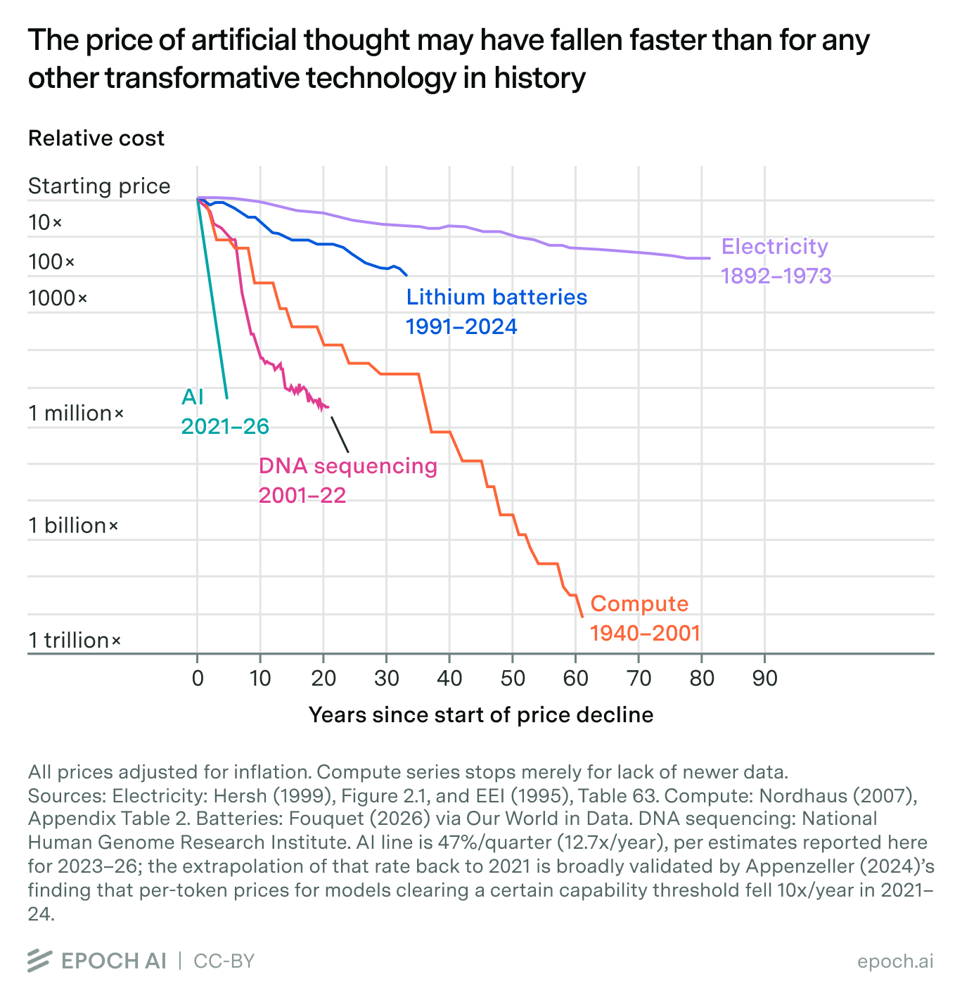

## TL;DR
- 具身大脑这个概念在未来不一定会存在，它只是LLM众多能力的分支之一，而不是一个完全独立的模型。
- 云端推理的延迟已经接近2Hz，LLMs会吃掉具身基座模型的生态位。
- 端侧模型的任务是following和safety，而非独立完成任务。
- 模型层面还没解决的问题主要在Sim2Real和Evaluation。

## Introduction

2025年开始，OpenAI 和 Anthropic 就开始逐渐开始参与 Robotics 的相关工作。RoboAgent 更是早在 2022 年就开始被研究（[Code as Policies](https://arxiv.org/abs/2209.07753)）。然而，过往的 LLM for Robotics 一直没有引起大家特别广泛的关注，直到 Anthropic 发布了 [Project Fetch](https://www.anthropic.com/research/project-fetch-robot-dog) ，以及 9 月 GPT-6 Astra 在各种任务上的出色表现，这个方向才重新火了起来。

一年前的Claude和GPT还完全没有办法完成最简单的关节操控，需要非常复杂的控制逻辑来实现操作，让我觉得LLMs还需要走非常远的路径，才能达到这样的效果。
然而，短短一年后，事情就完全发生了变化。GPT-6Astra在二指夹爪抓取任务上已经有了极强的泛化能力，且能够持续试错和迭代，以完成更加复杂的任务。在这样的条件下，我们认为的「特化模型」就不具备它们本来应有的优势了。

因此，我们需要思考：未来，Robotics Researchers，尤其是那些过去从事大脑研究的Robotics Researchers，需要走向何方？

## Part 1: Does Robotics Need a Foundation Model?

就目前整个具身行业来看，引领行业先进水平的开源真机端侧模型，仍然是 [Physical Intelligence](https://www.pi.website) 在2025年4月发布的 [π0.5](https://www.pi.website/blog/pi05)。
在今年上半年中国的具身热潮中，我们看到的各种Demo，除了极少数是用自研模型调试出来的，大部分也仍然选择了 π0.5作为基座来微调。

用过 π0.5的人都能感受到，π0.5这样的模型可以在单一场景下很好地过拟合，但没有办法对文本和场景有更广泛的理解。这种限制来源于模型本身的参数以及数据量不足。
我们可以把最近很长一段时间内有出色表现的VLA / WAM做一个参数量和数据量的比较：

<figure class="blog-figure" style="display: block; margin: 1.5em auto; text-align: center">

<figcaption>Model Size vs. Training Data</figcaption></figure>

Scaling is a science，如果我们真的期待能够实现具身基座的大脑，我们必须要承认参数量和数据量带来的巨大作用。或许 [Natura-1](https://www.naturewill.com/blog/natura-1#heading-observations) 是最近几个月当中最令人印象深刻的 Robotics Foundation Model，但是我们也可以看到，即便参数量增加到了 50B 这样的规模，模型展现出来的能力仍然不能满足真实使用场景。

所以，具身真的需要一个基座模型吗？我认为是否定的。System2已经证明了自己在Generalization上的实力，Robotics Intelligence不会是一个完全独立的学科，而是会和Coding、AI4Science一样，是LLM的一种Application。

不妨让我们一起来想象一下未来Robotics的实现形式：
1. 我们会有一个LLM System2，理解我们的指令，并翻译成某种信息传递到端侧的机器人上（目前设想的一种形式是eef pose），并保持延迟在200～400ms之间。
2. 我们会有一个端侧的Adapter，这个Adapter主要起到两个作用：
	- 根据System2的信息做following，在contact rich场景下对tactile做快速响应，（几乎）不需要规划能力；或者根据vision和电机信号持续接收反馈，调整决策。
	- 在网络波动的时候，能最低程度完成任务，或者回到安全模式（比如切菜的时候断网，可以把刀放在合适的位置）。

<figure class="blog-figure" style="display: block; margin: 1.5em auto; text-align: center">

<figcaption>Cloud System 2 + On-device Adapter</figcaption></figure>

在这一点上，我很赞同 Robbyant 沈宇军老师在26年9月外滩大会的判断——具身模型最终会成为高层大模型调用的工具。

## Part 2: Latency & Cost that Others May Be Concerned About
LLMs 有很多 Limitations 被大家提出，这里是一些比较常见的想法：
1. 延迟能否降得足够低，以支持响应式的闭环控制？(ref. [Shitao Tang](https://x.com/TsT87648373/status/2121695916654842158), [Astranomy](https://research.nvidia.com/labs/srl/projects/astranomy/index.html), [SemiAnalysis](https://newsletter.semianalysis.com/p/a-brain-too-big-to-carry-on-device))
2. 成本是否能够降得足够低，以支持机器人真正完成现实任务？(ref. [Astranomy](https://research.nvidia.com/labs/srl/projects/astranomy/index.html), [InferenceWire](https://inferencewire.com/insights/ai-models-are-learning-to-run-robot-arms-but-slowly))

### Simple Calculations for Latency

在和我讨论 LLMs 对具身基座模型的冲击时，很多人最关心的是 Latency。从目前的观察来看，GPT-6 Astra 或 Fable 5.2 这样的模型，在 simulation 中完成一次 pick & place 大约需要 50s（thinking=high, single trial）。但我认为这样的担忧是多余的。VLA 之所以能做到实时控制，是因为 VLM 只需要单次 forward，再由 action expert 根据这些信息输出 action。最简单的做法，是对 Astra 采取同样的思路：通过 IDM 或 joint forward，让 Astra 接上 action expert，直接输出 action。如果 Astra 能达到 100+ TPS，只要 OpenAI 愿意部署，在不考虑超长 memory prefill 的情况下，云端输出一个 action 的 latency 也不过尔尔。

我们可以做一些更细致的 calculations。由于 GPT-6 Astra 并未 open source，我们这里以 [DeepSeek V4.1 Flash](https://huggingface.co/deepseek-ai/DeepSeek-V4.1-Flash) （下称 DSV4.1 Flash）为例进行计算（552B, prefill 8B / decode 16B Activated, Non-Think）。

先把一次云端调用的延迟拆成网络和服务端两部分。

$$
T_{\text{call}} = T_{\text{net}} + T_{\text{server}}
$$

$$
T_{\text{net}} = T_{\text{RTT}} + T_{\text{upload}},\qquad
T_{\text{server}} = T_{\text{ViT}} + T_{\text{prefill}} + T_{\text{think}} + \frac{N_{\text{out}}}{R_{\text{decode}}}
$$

双臂桌面操作，3 路 640×480 相机（head + 2 wrist），Non-think。输出双臂的 xyz、rpy 和夹爪开合，共 14 个数，约 40 token，decode 按 200 tok/s。system prompt 和任务描述放在 prefix cache 里，每步只 prefill 新一帧观测。

- **图像 token**：一张 640×480 切成 1,610 个 14×14 patch，3×3 下采样后加上换行和分隔 token，共 206 个（ref. [DSV4.1 Flash image_processor](https://huggingface.co/deepseek-ai/DeepSeek-V4.1-Flash/blob/main/inference/image_processor.py)）。三路加约 100 token 文本，\\(N_{\text{new}} \approx 0.72\text{k}\\)。
- **ViT**：自带编码器约 411M 参数，加 73M 的 aligner（ref. [DSV4.1 Flash config](https://huggingface.co/deepseek-ai/DeepSeek-V4.1-Flash/blob/main/config.json)）。三路 4,830 个 patch 约 \\(5.1\times10^{12}\\) FLOPs，在一张 B300 上按 BF16 2.25 PFLOPS、利用率 30% 算约 7.5 ms，加上开销取 15 ms。
- **Prefill**：较快线路的 TTFT 约 0.3 s，扣掉一次网络往返后按 0.25 s 计，短输入下这部分主要是排队和调度。
- **Think**：Non-think 时为 0。开 Max 档 thinking 时，time to first answer token 是 12.41 s（ref. [Novita](https://novita.ai/compare/open-source-llm-vs-proprietary-llm)）。
- **Action expert**：现有 API 只能用文本输出 action。如果能接 π0 那样的 action expert（300M 参数，10 步 flow matching），这一项约 3 ms。

经过计算，我们可以得到如图结果。

<figure class="blog-figure" style="display: block; margin: 1.5em auto; text-align: center">

<figcaption>Cloud Call Latency</figcaption></figure>

在非跨国场景下，现阶段的 Latency 仍然保持在 2Hz 左右的频率，这样的 Latency 一定程度上是可接受的。这是因为，在我们的测试条件下，如果希望不降低效果，端侧芯片例如 NVidia 的 Orin AGX，运行常见 5B 左右的 WAMs 也很难达到 500ms 的时延，VLAs也只能控制在200ms左右，相比于云端方案不会有明显的优势。

此外，我们可以想见，大规模云端推理延迟，由于有更多的需求和更多场景（OpenAI Anthropic 等公司也更有钱），因此相比于端侧，会更快被solve。

### Simple Calculations for Cost

另一个经常被 challenge 的点是成本。我们可以来做一些简单的计算。我们以 GPT-6 Astra为例，如果每天实际工作时长8h，推理频率为2Hz。我们暂且先采用 Codex Pro 20x($200) 的 subscription 来计算（这是因为API Key价格太高，有些失真）。

一天的调用次数：

$$
N_{\text{day}} = 2\ \text{Hz} \times 8 \times 3600\ \text{s} = 57{,}600
$$

每次调用的固定前缀 2k token，命中缓存；新观测 1,180 token，其中三张图按 Astra 的规则每张 360 token（ref. [OpenAI Images and vision](https://developers.openai.com/api/docs/guides/images-vision)），另加约 100 token 文本；输出 40 token。Astra 在 Codex 订阅里每百万 token 消耗输入 250、缓存命中约 25、输出 1,250 credit（ref. [usepoly](https://usepoly.co/codex-pricing)）：

$$
c_{\text{call}} = \frac{\underbrace{2{,}000 \times 25}_{\text{前缀}} + \underbrace{1{,}180 \times 250}_{\text{新观测}} + \underbrace{40 \times 1{,}250}_{\text{输出}}}{10^6} = 0.05 + 0.295 + 0.05 = 0.395\ \text{credit}
$$

$$
c_{\text{month}} = 0.395 \times 57{,}600 \times 30 \approx 68.3\ \text{万 credit}
$$

其中图像约占 68%。一份 Pro 200（\$200/月）约含 14 万 credit（ref. [BenchLeader](http://www.benchleader.com/coding-plans/codex-pro-500)），一台机器人需要：

$$
\left\lceil \frac{68.3\ \text{万}}{14\ \text{万}} \right\rceil = 5\ \text{份 Pro 200}
$$

即每月约 \$1,000，每天约 \$33。

<figure class="blog-figure" style="display: block; margin: 1.5em auto; text-align: center">

<figcaption>Cost per Robot</figcaption></figure>

此外，我们可以想见，如果 LLMs for Robotics 真的成为了被 LLM Companies 关注的重要议题，那么成本一定会继续下降（ref. [Epoch AI](https://epoch.ai/publications/the-plunging-price-of-thought)）。按照算力成本每年降低50%来看（这是一个非常保守的估计），我们很快就能够拥有足够便宜的 Robotics 产品，这个时间会在 1～2 年内到来。

我们也可以参考 Epoch AI 统计的技术降价速度：在固定的能力水平下，AI 的成本自 2023 年以来每个季度下降约 47%，折合每年便宜 12.7 倍，比 DNA 测序、算力、锂电池和电力在历史上的降价都要快。一个更直观的例子是，在 GPQA Diamond 上拿到 75%，o3 在 2025 年初每题大约需要 \$0.30，不到 18 个月后，GPT-5.6 Luna 只需要 \$0.0004，便宜了 725 倍。如果按这个速度来算，上面每台机器人每月约 \$1,000 的成本，一年后就会降到 \$100 以内。

<figure class="blog-figure" style="display: block; margin: 1.5em auto; text-align: center"><figcaption>Source: Emberson &amp; Roodman, Epoch AI (2026), CC BY 4.0</figcaption></figure>

## Conclusion

所以，VLA / WAM Researchers 到底要走向何方呢？我们可以知道的是，如果不是为了短期落地考虑，无论是 VLA 还是 WAM，亦或是其他希望 scale 具身自己的基座模型的工作，都没有办法阻挡 LLMs 的滚滚洪流（是的我就是降临派）。

如果真的希望解决具身大脑的问题，在 LLM Companies 投身预训练和后训练可能是更好的选择，做好数据工作，搞清楚 Ego、UMI、遥操数据对 LLM pre/post training 的价值。

当然，Robotics 还有很多未解决的问题，硬件的迭代周期暂且不论，我们在模型层面至少还有几个层面的问题：
1. Sim2Real：Robotics仍然没有很好的仿真环境来rollout。无论是simulator、world model，还是code as policy，都需要更多研究来解决大规模并行强化学习，并降低sim2real gap。
2. Evaluation。大Bench理论已经教会我们：在任何一个领域，一个好的Benchmark能够解决大量真实问题。对Robotics而言，目前的仿真Benchmark无法代表真机表现，而真机的Benchmark又出现大量hack，以及多样性、表现力不足的情况。

## Reference

1. Liang et al. (2022). *Code as Policies: Language Model Programs for Embodied Control*. [arXiv:2209.07753](https://arxiv.org/abs/2209.07753)
2. Anthropic. *Project Fetch*. [Anthropic Research](https://www.anthropic.com/research/project-fetch-robot-dog)
3. Physical Intelligence (2025). *π0.5: a Vision-Language-Action Model with Open-World Generalization*. [Blog](https://www.pi.website/blog/pi05), [arXiv:2504.16054](https://arxiv.org/abs/2504.16054)
4. Nature Will (2026). *Natura-1: The Will to Act*. [Blog](https://www.naturewill.com/blog/natura-1)
5. Black et al. (2024). *π0: A Vision-Language-Action Flow Model for General Robot Control*. [arXiv:2410.24164](https://arxiv.org/abs/2410.24164)
6. NVIDIA (2026). *Isaac GR00T*（GR00T N1.7）. [GitHub](https://github.com/NVIDIA/Isaac-GR00T)
7. Wu et al. (2026). *A Pragmatic VLA Foundation Model*（LingBot-VLA）. [arXiv:2601.18692](https://arxiv.org/abs/2601.18692)
8. Wang et al. (2026). *Qwen-VLA: Unifying Vision-Language-Action Modeling across Tasks, Environments, and Robot Embodiments*. [arXiv:2605.30280](https://arxiv.org/abs/2605.30280)
9. Liu et al. (2026). *RDT2: Exploring the Scaling Limit of UMI Data Towards Zero-Shot Cross-Embodiment Generalization*. [arXiv:2602.03310](https://arxiv.org/abs/2602.03310)
10. Luo et al. (2026). *Being-H0.5: Scaling Human-Centric Robot Learning for Cross-Embodiment Generalization*. [arXiv:2601.12993](https://arxiv.org/abs/2601.12993)
11. Jiang et al. (2025). *Galaxea Open-World Dataset and G0 Dual-System VLA Model*. [arXiv:2509.00576](https://arxiv.org/abs/2509.00576)
12. GigaBrain Team (2025). *GigaBrain-0: A World Model-Powered Vision-Language-Action Model*. [arXiv:2510.19430](https://arxiv.org/abs/2510.19430)
13. Figure (2025). *Helix: A Vision-Language-Action Model for Generalist Humanoid Control*. [Blog](https://www.figure.ai/news/helix)
14. Xiaomi Robotics Team (2026). *Xiaomi-Robotics-1: Scaling Vision-Language-Action Models with over 100K Hours of Real-World Trajectories*. [arXiv:2607.15330](https://arxiv.org/abs/2607.15330)
15. Ye et al. (2026). *World Action Models are Zero-shot Policies*（DreamZero）. [arXiv:2602.15922](https://arxiv.org/abs/2602.15922)
16. Yuan et al. (2026). *Fast-WAM: Do World Action Models Need Test-time Future Imagination?* [arXiv:2603.16666](https://arxiv.org/abs/2603.16666)
17. Ye et al. (2026). *GigaWorld-Policy: An Efficient Action-Centered World-Action Model*. [arXiv:2603.17240](https://arxiv.org/abs/2603.17240)
18. Liao et al. (2025). *Genie Envisioner: A Unified World Foundation Platform for Robotic Manipulation*. [arXiv:2508.05635](https://arxiv.org/abs/2508.05635)
19. Pai et al. (2025). *mimic-video: Video-Action Models for Generalizable Robot Control Beyond VLAs*. [arXiv:2512.15692](https://arxiv.org/abs/2512.15692)
20. Assran et al. (2025). *V-JEPA 2: Self-Supervised Video Models Enable Understanding, Prediction and Planning*. [arXiv:2506.09985](https://arxiv.org/abs/2506.09985), [Meta Blog](https://ai.meta.com/blog/v-jepa-2-world-model-benchmarks/)
21. BeingBeyond Team (2026). *Being-H0.7: A Latent World-Action Model from Egocentric Videos*. [arXiv:2605.00078](https://arxiv.org/abs/2605.00078), [Project Page](https://research.beingbeyond.com/being-h07)
22. Qwen Team (2026). *Qwen-RobotManip Technical Report: Alignment Unlocks Scale for Robotic Manipulation Foundation Models*. [arXiv:2606.17846](https://arxiv.org/abs/2606.17846)
23. DeepSeek-AI (2026). *DeepSeek-V4.1-Flash*（模型卡、config 与 image_processor）. [Hugging Face](https://huggingface.co/deepseek-ai/DeepSeek-V4.1-Flash)
24. ProviderBench. *Fastest DeepSeek V4.1 Flash Inference Providers*. [ProviderBench](https://providerbench.ai/models/deepseek/deepseek-v4.1-flash/fastest/)
25. Novita AI. *Open-source vs proprietary LLMs*（引用 Artificial Analysis 的 DeepSeek V4.1 Flash 1017 (Max) 数据）. [Novita](https://novita.ai/compare/open-source-llm-vs-proprietary-llm)
26. OpenAI. *Images and vision*（图像 token 计算规则）. [OpenAI API Docs](https://developers.openai.com/api/docs/guides/images-vision)
27. usepoly. *Codex plans and pricing (2026)*（credit 消耗速率）. [usepoly](https://usepoly.co/codex-pricing)
28. BenchLeader. *Codex Pro 500: limits, models and real cost*. [BenchLeader](http://www.benchleader.com/coding-plans/codex-pro-500)
29. Yao, S. (2025). *The Second Half*. [Blog](https://ysymyth.github.io/The-Second-Half/)
30. RoboDojo Team (2026). *RoboDojo: A Unified Sim-and-Real Benchmark for Comprehensive Evaluation of Generalist Robot Manipulation Policies*. [Project Page](https://robodojo-benchmark.com/)
31. Atreya et al. (2025). *RoboArena: Distributed Real-World Evaluation of Generalist Robot Policies*. CoRL 2025. [arXiv:2506.18123](https://arxiv.org/abs/2506.18123)
32. *RobotArena ∞: Scalable Robot Benchmarking via Real-to-Sim Translation*. [arXiv:2510.23571](https://arxiv.org/abs/2510.23571)
33. roboind.com. *大 Bench 时代，RoboColiseum 如何构建具身评测？*. [Article](https://www.roboind.com/news/show-htm-i-910228087-0f5a32700ea33a6139f12c72/)
34. NVIDIA. *Isaac Lab: A GPU-Accelerated Simulation Framework for Multi-Modal Robot Learning*. [GitHub](https://github.com/isaac-sim/IsaacLab)
35. Emberson, L. & Roodman, D. (2026). *The Plunging Price of Thought*. Epoch AI, CC BY 4.0. [Epoch AI](https://epoch.ai/publications/the-plunging-price-of-thought)
36. Yang, Khetan & Zhang (2026). *Astranomy: An Empirical Study of GPT-6 Astra as a Native Robot Policy*. NVIDIA SRL, CoRL 2026 LBR. [Project Page](https://research.nvidia.com/labs/srl/projects/astranomy/index.html)
37. SemiAnalysis (2026). *A Brain Too Big to Carry — On-Device vs Datacenter Inference*. [Newsletter](https://newsletter.semianalysis.com/p/a-brain-too-big-to-carry-on-device)
38. Asghar, A. R. (2026). *AI Models Are Learning to Run Robot Arms, but Slowly*. InferenceWire. [Article](https://inferencewire.com/insights/ai-models-are-learning-to-run-robot-arms-but-slowly)

<!-- obsidian_publish_id: 1794932867404-gqk9udgc -->
